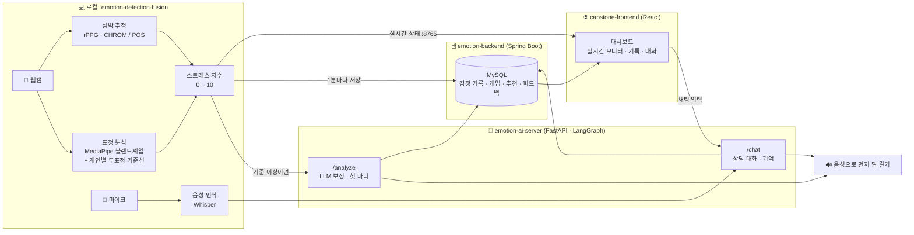

<div align="center">

# 🫧 emotion-ai

### 표정과 심박으로 스트레스를 알아차리고, AI가 먼저 말을 거는 감정 케어 에이전트

*멀티모달 감정 인식 기반 선제적 개입 AI 에이전트 시스템 · 2026 졸업작품*


</div>

---

## 💡 이런 시스템입니다

사람은 힘들어도 먼저 도움을 청하지 않습니다. **emotion-ai**는 웹캠 하나로 사용자의 **표정**과 **심박**을 읽어 스트레스 지수를 계산하고, 지수가 기준을 넘으면 **AI 에이전트가 먼저 말을 겁니다.**

> "오늘 좀 지쳐 보이네요. 무슨 일 있었어요?"

말을 건 뒤에는 음성이나 웹 채팅으로 **대화가 이어집니다.** 에이전트는 지난 대화를 기억하고, 공감하며 질문하고, 작은 마음 돌봄을 권합니다. 모든 기록은 웹 대시보드에서 확인할 수 있습니다.

| | |
|---|---|
| 👀 **보는 것** | 표정(MediaPipe 블렌드셰입 52개) + 같은 영상에서 뽑은 웹캠 심박(rPPG) |
| 🧮 **계산하는 것** | 개인별 기준선을 반영한 스트레스 지수 0~10 |
| 🗣️ **하는 일** | 기준을 넘으면 먼저 말 걸기 → 음성·채팅 상담 대화 → 기록 저장 |
| 📊 **보여주는 것** | 실시간 모니터, 감정 기록, 개입 이력을 담은 웹 대시보드 |

---

## 🧭 전체 구조



---

## ✨ 핵심 기능

### 1. 표정 + 심박을 합친 스트레스 지수
표정만으로는 애매하고, 심박만으로는 운동·커피 같은 변수에 흔들립니다. 두 신호를 함께 보되 **개인차를 먼저 보정**합니다.

```
지수 = 10 × ( 0.35 × 부정 정서 + 0.35 × 심박 상승 + 0.10 × 표정 각성 + 0.20 × 기복 )
```

- **개인별 무표정 기준선**: 처음 60초 동안 이 사람의 무표정을 기록하고, 평소보다 올라간 만큼만 표정으로 읽습니다.
- **평상시 심박 보정**: 처음 구간으로 평상시 심박을 잡고, 그보다 얼마나 올랐는지를 사용합니다.
- **절반·두 배 오류 방지**: 웹캠 심박에서 자주 생기는 절반 값(50~60bpm)이 섞이면 규칙으로 걸러냅니다.
- **심박이 안 잡혀도 동작**: 보정에 실패하면 표정만으로 계산하고, 나중에 잡히면 융합으로 돌아옵니다.

| 상황 (합성 데이터 시험) | 지수 | 개입 기준 6점 |
|---|:---:|:---:|
| 평온 | 0.0 | — |
| 심박만 +20bpm | 3.5 | 미만 |
| 부정 표정만 | 3.5 | 미만 |
| **부정 표정 + 심박 +20bpm** | **7.0** | **개입** |
| 미소 + 심박 +20bpm (신남, 운동 직후) | 4.1 | 미만 |

### 2. 먼저 말을 거는 상담형 에이전트
- 기준을 넘으면 **상태를 알아차렸다는 말 + 열린 질문**으로 시작합니다.
- 이후 **음성이나 웹 채팅**으로 대화가 이어집니다. 공감하고, 질문은 한 번에 하나씩, 작은 마음 돌봄을 권합니다.
- **지난 대화를 기억합니다.** 대화 요약, 30분마다 만드는 혼잣말 요약, 최근 발화를 프롬프트에 반영합니다(7일 보관).
- **스트리밍 응답**: 첫 문장이 완성되면 바로 음성으로 읽기 시작합니다.
- **안전장치**: 자해를 암시하는 말에는 109(자살예방상담전화)를 안내하고 대화를 끝내지 않습니다.

### 3. 웹 대시보드
- **실시간 모니터**: 지금의 표정, 심박, 지수와 얼굴 인식 화면을 확인하고 대화 말풍선을 봅니다.
- **감정 기록 · 개입 이력**: 감정 분포, 감정 타임라인, 스트레스 추이, 개입과 사용자 평가를 모아 봅니다.
- **대화창**: 음성과 채팅 대화를 한 화면에서 이어 갑니다.

### 4. 연구·검증을 위한 장치
- 1초 단위 세션 CSV와 사건 CSV 기록 (논문 그래프용)
- 규칙 기반 표정 vs 학습된 표정 모델(HSEmotion) 비교 옵션
- 갤럭시 워치 심박과의 시간대별 비교 도구
- 시연용 데이터 생성기 (`tools/demo_data.py`, **실제 측정이 아닌 화면 시연용**)

---

## 🗂️ 저장소 구성

기존에 모듈마다 나뉘어 있던 레포를 이 저장소 하나로 합쳤고, **각 모듈의 커밋 히스토리는 그대로 보존**했습니다.

| 폴더 | 역할 | 기술 |
|---|---|---|
| [`emotion-detection-fusion/`](emotion-detection-fusion) | 감지 · 지수 계산 · 개입과 대화 흐름 | Python, OpenCV, MediaPipe, Whisper |
| [`emotion-ai-server/`](emotion-ai-server) | 에이전트 서버 · 상담 대화 · 추천 | FastAPI, LangGraph, OpenAI / Ollama |
| [`emotion-backend/`](emotion-backend) | 감정 기록 · 개입 · 추천 · 피드백 저장 | Java 17, Spring Boot 3.2, JPA, MySQL |
| [`capstone-frontend/`](capstone-frontend) | 웹 대시보드 | React 19, TypeScript, Vite, Tailwind, Recharts |
| [`legacy/emotion-detection/`](legacy/emotion-detection) | 1학기 감지 코드 (DeepFace 기반, 참고용) | Python |

---

## 🚀 실행해 보기

네 부분을 아래 순서로 띄웁니다. 각 폴더의 `README.md`와 `.env.example`에 자세한 설정이 있습니다.

**0. 준비**: MySQL(DB `capstone`), 그리고 LLM으로 OpenAI 키 또는 [Ollama](https://ollama.com)

**1. 백엔드** (포트 8080)
```bash
cd emotion-backend
export DB_PASSWORD=<MySQL 비밀번호>
./gradlew bootRun
```

**2. 에이전트 서버** (포트 8000)
```bash
cd emotion-ai-server
pip install -r requirements.txt
cp .env.example .env        # 키와 모델 설정 입력
uvicorn main:app --reload --port 8000
```

**3. 감지 프로그램**
```bash
cd emotion-detection-fusion
pip install -r requirements.txt
cp .env.example .env
python main.py              # 대화에는 STT_MODE=vad 권장
```
> 약 20초 뒤 심박 표시가 시작되고, 약 1분 20초 뒤 평상시 심박 보정이 끝나면 개입이 가능해집니다. 보정 중에는 편하게 앉아 있어 주세요.

**4. 웹**
```bash
cd capstone-frontend
cp .env.example .env
npm install && npm run dev
```

**시연 팁**: 웹의 ⚡ 버튼이나 카메라 창에서 `i` 키를 누르면 지수와 상관없이 개입을 바로 시작할 수 있습니다.

### 카메라 없이 시험하기
```bash
cd emotion-detection-fusion
python tests/test_offline.py        # 지수 계산, 합성 데이터
python tests/test_face_affect.py    # 표정 기준선
python tests/test_rppg_timed.py     # 심박 추정
```

---

## 📈 지금까지의 검증과 한계

솔직하게 현재 상태를 적습니다.

- ✅ 맥북 에어 웹캠으로 실제 측정을 여러 차례 진행했습니다(얼굴 인식 97~100%).
- ✅ 웹캠 심박을 갤럭시 워치 기록과 시간대별로 비교하는 예비 검증을 했습니다. 한 사람·한 번의 기록에서 평균 절대 오차 약 3.2bpm, 상관계수 0.82였습니다.
- ⚠️ 위 검증은 **표본이 한 사람**이라 일반화할 수 없습니다. 스트레스 지수의 **가중치와 기준값은 초기값**이며 더 많은 데이터로 보정해야 합니다.
- ⚠️ 이 시스템은 **의료 기기나 진단 도구가 아닙니다.** 스트레스 지수는 상태를 알아차리기 위한 참고 값입니다.
- 🔭 앞으로: 소규모 사용자 평가, 공개 데이터셋(UBFC-Phys, K-EmoCon)과의 비교, 스마트워치 실시간 연동, 가중치 보정

---

## 🔒 개인정보와 데이터

- 카메라 영상과 얼굴 분석은 **사용자 컴퓨터 안에서 처리**됩니다. 웹 모니터의 얼굴 인식 화면도 이 컴퓨터(127.0.0.1)에서만 열리고 저장하지 않으며, 서버로는 계산된 수치만 보냅니다.
- 대화 텍스트는 설정에 따라 외부 서비스(OpenAI LLM, edge-tts 음성 합성 등)로 전송될 수 있습니다. 로컬만 쓰려면 Ollama와 `say` 음성을 선택하세요.
- `.env`, 로그(`logs/`), 음성 파일은 저장소에 포함되지 않습니다(`.gitignore`).
- 대화 기록은 평가 자료로 남기도록 되어 있으니, 실제 사용자에게 쓸 때는 **사전 동의**를 받으세요.

---

<div align="center">

**emotion-ai** · 2026 졸업작품

</div>
